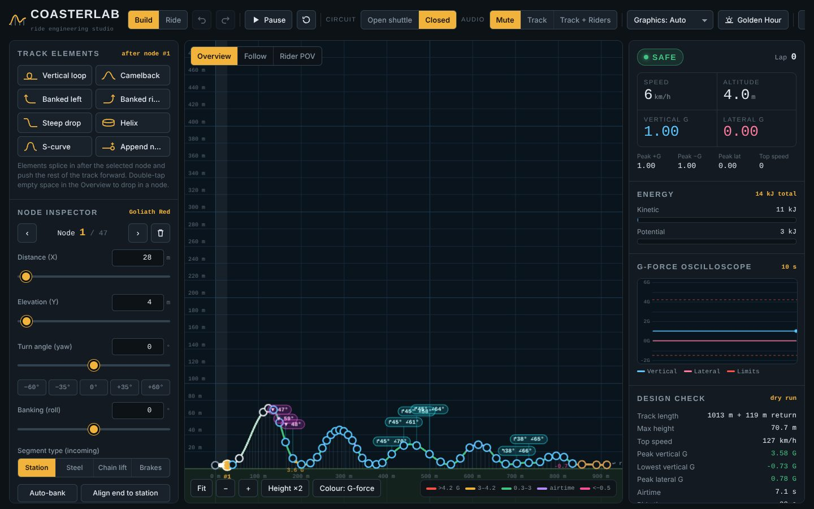
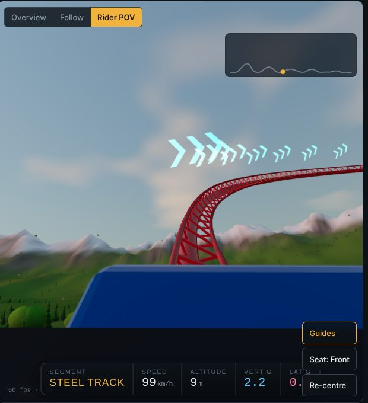

# CoasterLab

**▶ [Play it here](https://dtech.github.io/CoasterLab/)**

A real-time physics roller coaster builder, telemetry analyzer and 3D rider simulator that runs in the browser. You sculpt a track in a side-profile editor, check its speeds and G-forces with a dry-run simulation, then ride it in first person through procedurally generated scenery.

It is a single HTML page built on [three.js](https://threejs.org/) (WebGL). Nothing to install, no build step needed to play. It targets high-end Android phones (Galaxy S26 Ultra class) and laptops with a discrete GPU (tested target: GeForce RTX 4060 Laptop).


## Quick start

1. Open `index.html` in Chrome, Edge or Firefox. You can also serve the folder from any static host, such as GitHub Pages with the repo root as the source.
2. On the start screen pick **Ride the Hyper-Goliath** for a first-person ride, or **Open the builder** to start designing.
3. Click the CoasterLab logo at the top left to come back to the start screen at any time.

The page needs an internet connection on first load. It fetches three.js from jsDelivr and fonts from Google Fonts (see [Running offline](#running-offline)).


## Features

### Track builder
- **Profile editor.** The track is an ordered list of control nodes joined by a natural cubic spline, drawn over a scaled engineering grid. Drag nodes to reshape the track. Double-click (or double-tap) empty space to insert a node on the nearest segment. Pinch or scroll to zoom, and use **Height ×1/×2/×3** to exaggerate elevation for easier editing.
- **Element splicing.** Insert a vertical loop (clothoid teardrop sized to the predicted entry speed), camelback hill, banked left or right turn, steep drop, helix or S-curve after the selected node. Every node downstream shifts forward by the element's span, so the track never folds back on itself.
- **Node inspector.** Step through nodes with previous and next, then set distance, elevation, turn angle (yaw, ±90°) and banking (roll, ±80°) with sliders or numeric fields. Quick yaw buttons cover −60° to +60°, and the segment type can be Station, Steel, Chain lift or Brakes.
- **Auto-bank** sets the roll that cancels most of the sideways force at the speed the simulation predicts for that node. **Align end to station** levels the last node with the platform.
- **Live design check.** Each edit re-runs a dry-run simulation. The track is coloured by predicted G-force or speed, peak G points are labelled, and a stall marker shows where the train would run out of energy.
- **Badges** above nodes flag turns (↱/↰), banking (∠) and steep drops (▼).
- **Circuit modes.** *Closed* adds a return transfer track back to the station and counts laps. *Open shuttle* lets the train stop or roll back at the end, as on a boomerang.
- **Undo and redo** keep 40 steps of history, covering node drags, sliders, inserts, deletes, preset loads and circuit changes.



### Simulation and telemetry
- **Kinematics.** The train moves by arc length with gravity averaged over its six cars, plus rolling friction and aerodynamic drag. Chain lifts pull at a fixed 4.4 m/s, and magnetic brakes trim to 7.5 m/s mid-course or stop at the end. Drive tyres handle dispatch and the return transfer.
- **G-forces.** Vertical and lateral G come from track curvature, speed, tangential acceleration and gravity, resolved into the rider's banked frame. Session peaks are recorded.
- **Oscilloscope.** A scrolling 10-second trace of vertical and lateral G with limit lines.
- **Energy.** Live kinetic and potential energy in kJ.
- **Safety alerts.** A banner fires on HIGH G WARNING (> 4.2 G), BLACKOUT RISK (> 5.5 G), REDOUT RISK (< −1.5 G) or LATERAL G WARNING (> 1.8 G), with Clear and Dismiss controls. In the rider view, high G greys out and negative G reddens the edges of the screen.

### 3D views
- **Follow cam.** A chase camera that tracks the train. Drag to orbit and scroll or pinch to zoom.
- **Rider POV.** A first-person seat (front or rear) that pitches, rolls and yaws with the track, with field of view widening at speed. Neon guide chevrons ahead flag upcoming turns, drops and loops. The cockpit HUD shows segment type, speed (km/h), altitude (m) and G-forces. Drag to look around; the view re-centres on its own.
- **Scenery.** Physically based sky with procedural clouds in four times of day, terrain rising into snow-capped mountains, a lake with animated normals, and thousands of instanced conifers, broadleaf trees, bushes, wind-swayed grass and rocks. A plaza and a turning Ferris wheel sit beside the station.
- **Track hardware.** Twin rails, a box spine, cross-ties, A-frame supports with footings, an animated lift chain, brake fins, a station with platforms and roof, and five paint schemes.



### Audio
Everything is synthesised with the Web Audio API, no sound files. There are three modes:
- **Mute**
- **Track:** chain-lift clack, speed-scaled rail rumble and wind, brake whine and drive-tyre hum.
- **Track + Riders:** adds multi-voice screams on drops, airtime, inversions and heavy-G moments, plus cheering when the train returns to the station.

### Saving
- The working design auto-saves on every change and is restored on the next visit.
- **Save / Load** keeps named designs. Saving to an existing name overwrites it, and Delete asks for confirmation.
- Export a design as blueprint JSON with **Copy JSON**, then import it by pasting or opening a `.json` file.

Saves live in that browser's local storage. To move a design between devices, export it on one and import it on the other.

## Presets

| Preset | Circuit | Length | Top speed | Peak +G | Lowest G | Peak lateral |
|---|---|---|---|---|---|---|
| Hyper-Goliath Mega Coaster (default) | Closed | 1,013 m | 127 km/h | 3.58 | −0.73 | 0.78 |
| Looping Corkscrew | Closed | 772 m | 95 km/h | 4.01 | −0.49 | 0.39 |
| Boomerang Shuttle | Open | 377 m | 101 km/h | 3.89 | −0.62 | 0.17 |
| Family Mine Train | Closed | 446 m | 54 km/h | 1.44 | 0.69 | 0.07 |
| Blank Slate (3 nodes) | Open | 60 m | — | — | — | — |

These figures come from `node tools/check_presets.js`. The Looping Corkscrew uses two loops, a turnaround and a helix rather than a true corkscrew, because banking is capped at ±80°.

## Controls

| Action | Mouse / keyboard | Touch |
|---|---|---|
| Move a node | Drag it (Overview, Build mode) | Drag it |
| Add a node | Double-click empty space | Double-tap empty space |
| Pan / zoom profile | Drag background / scroll wheel | Drag / pinch |
| Orbit or look around | Drag in Follow or Rider POV | Drag |
| Undo / redo | Ctrl+Z / Ctrl+Y (or Ctrl+Shift+Z) | Toolbar buttons |
| Play / pause | Space | Toolbar button |
| Delete selected node | Delete or Backspace | Bin button |
| Previous / next node | `[` / `]` | ‹ / › buttons |
| Overview / Follow / Rider POV | `1` / `2` / `3` | Camera switcher |
| Close a dialog | Esc | ✕ or tap outside |

**Build** mode allows editing. **Ride** mode locks editing, restarts the train from the station and switches to the rider view. On phones the layout stacks, and the 38% / 56% / 78% / Full buttons resize the viewport so the inspector stays within reach.

## Graphics and performance

**Graphics: Auto** chooses a quality tier from the GPU the browser reports:

| Tier | Typical device | Shadow map | Trees | Grass tufts |
|---|---|---|---|---|
| Low | Older phones, software renderers | 1024 | 3,200 | 7,000 |
| Medium | S26 Ultra class (Adreno 7xx/8xx, Immortalis, Xclipse 9xx) | 2048 | 7,000 | 22,000 |
| High | Desktop / laptop GPUs (NVIDIA, Radeon RX, Intel Arc) | 4096 | 13,000 | 48,000 |
| Ultra | Pick manually on strong GPUs | 4096 | 22,000 | 85,000 |

On top of the tier, dynamic resolution lowers the render scale when the frame rate stays under about 48 fps and raises it again above about 58 fps. The fps, tier and render scale appear at the bottom left of the 3D view, and the GPU name is shown under Design check. The renderer requests the high-performance GPU, so on a laptop with switchable graphics check that the browser is running on the discrete GPU.


## Project structure

```
index.html              Generated standalone app (open this)
src/
  template.html         Markup, start screen, dialogs and script loader
  style.css             Layout and theme
  core.js               Track spline, 3D frames, physics, G-forces, elements, presets
  world.js              three.js scene: sky, terrain, vegetation, track meshes, train, cameras
  ui.js                 Builder board, inspector, telemetry, audio synth, save/load, start screen
tools/
  build.py              Inlines src/ into index.html
  check_presets.js      Runs every preset through the physics and checks rider limits
docs/images/            README screenshots
```

### Building

```bash
python3 tools/build.py              # writes index.html
python3 tools/build.py --fragment   # writes dist/coasterlab-artifact.html (body-only version for a Claude artifact)
node tools/check_presets.js         # physics regression check; exits 1 if a preset stalls or exceeds limits
```

Edit files under `src/` and rebuild. Do not edit `index.html` by hand.

### Blueprint format

```json
{
  "app": "CoasterLab",
  "version": 1,
  "name": "My Coaster",
  "closed": true,
  "nodes": [
    { "x": 0,  "y": 4,  "yaw": 0,  "roll": 0,  "type": "station" },
    { "x": 28, "y": 4,  "yaw": 0,  "roll": 0,  "type": "station" },
    { "x": 56, "y": 12, "yaw": 0,  "roll": 0,  "type": "chain" },
    { "x": 90, "y": 30, "yaw": 45, "roll": 60, "type": "steel" }
  ]
}
```

`x` and `y` are in metres, and `yaw` and `roll` in degrees. `type` is the behaviour of the segment that leads *into* the node: `station`, `chain`, `steel` or `brakes`. Loop nodes can also carry a small `lat` value, the sideways offset that lets a loop's exit clear its entry. Imports clamp values to the editor's ranges.

## Running offline

The page loads three.js r160 as an ES module from jsDelivr, falling back to the classic r158 build if the module import is blocked. For a machine without internet access:

1. Download `three.module.min.js` from the [three.js r160 release](https://github.com/mrdoob/three.js/tree/r160/build) and put it next to `index.html`.
2. In `src/template.html`, change the `import('https://cdn.jsdelivr.net/npm/three@0.160.0/build/three.module.min.js')` URL to `'./three.module.min.js'`, then rebuild.
3. Serve the folder over HTTP (for example `python3 -m http.server`), because browsers block module imports from `file://` pages.

Without Google Fonts the page falls back to system fonts.

## Known limitations

- Banking is limited to ±80°, so full corkscrews and heartline rolls are not possible yet.
- Elevation is limited to 0–220 m and turns to ±90° per node.
- Track sections don't collide with each other, so a turn can route the track through an earlier section.
- Saved designs are per browser and per device (local storage only).

## Credits

- Rendering: [three.js](https://github.com/mrdoob/three.js) (MIT License)
- Fonts: Barlow, Barlow Condensed and JetBrains Mono via Google Fonts (SIL Open Font License)
