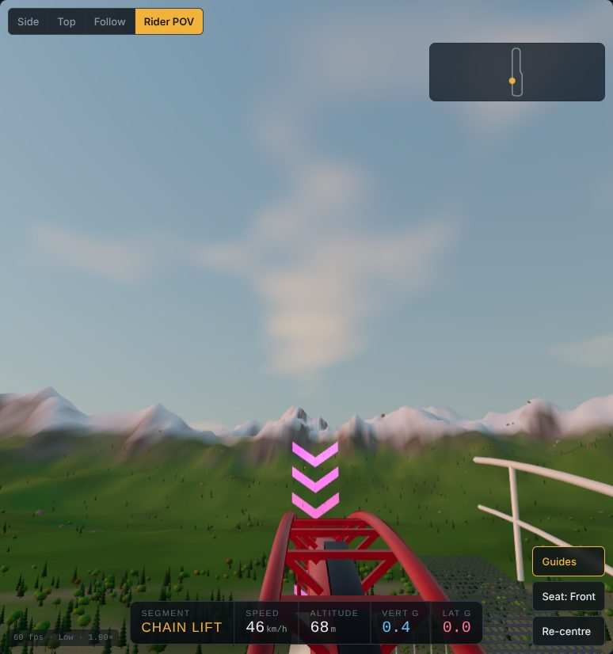
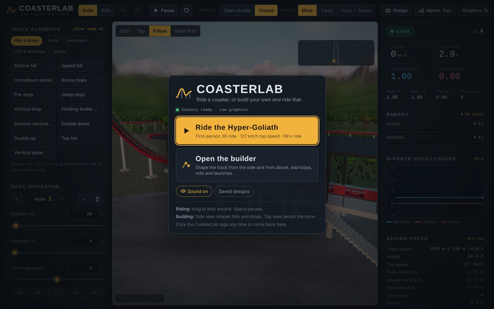
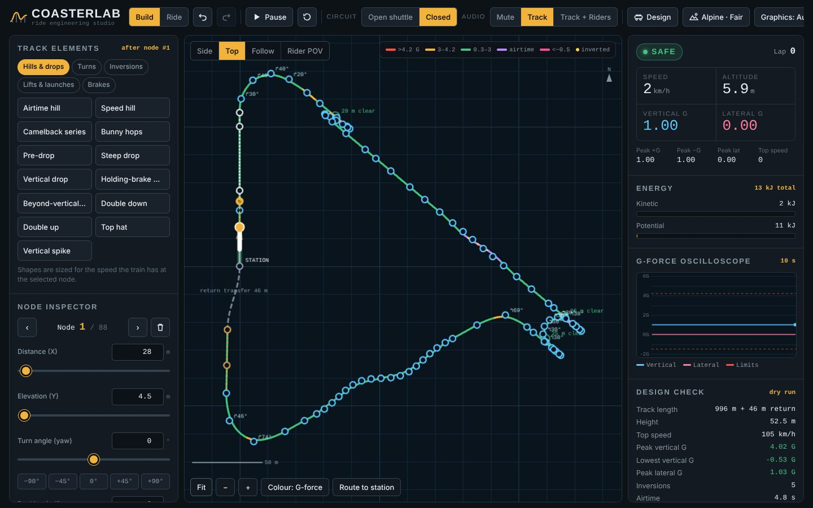
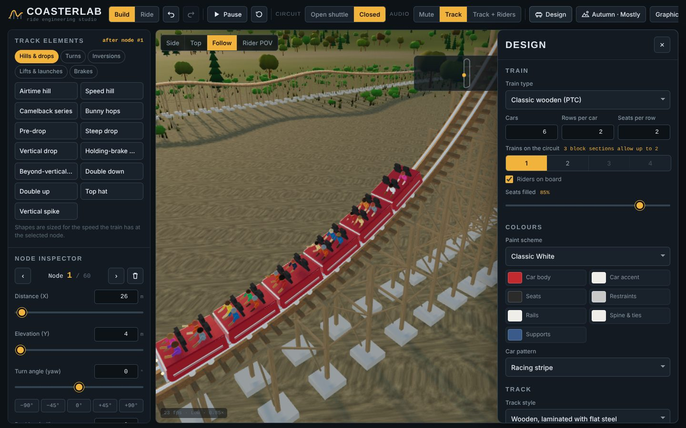
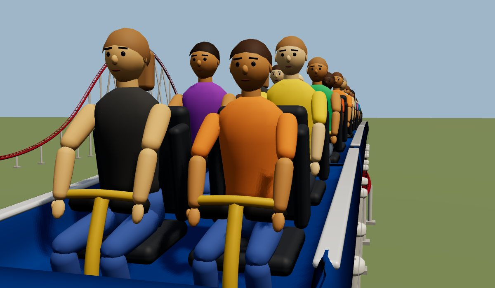
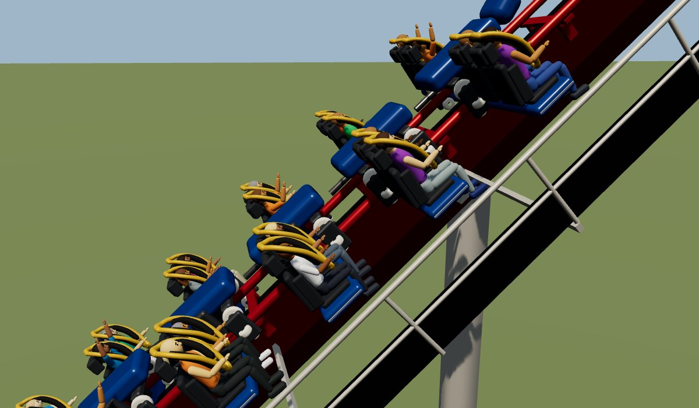
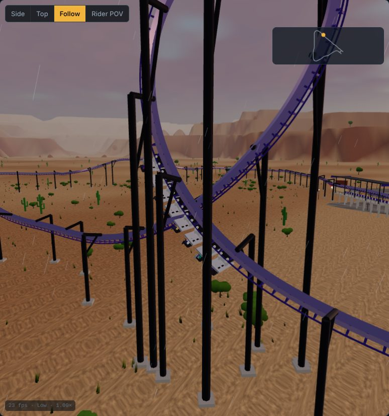
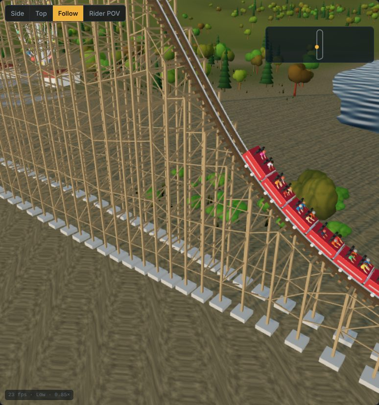
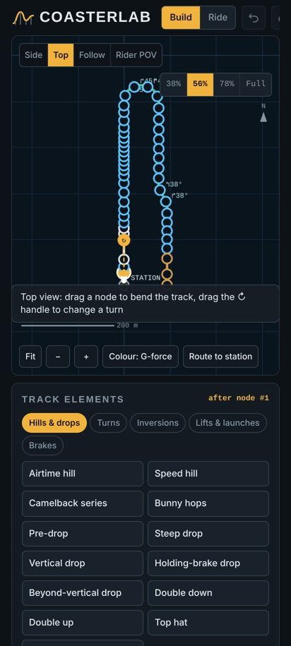

# CoasterLab

**▶ [Play it here](https://dtech.github.io/CoasterLab/)**

A real-time physics roller coaster builder, telemetry analyzer and 3D rider simulator that runs in the browser. You shape a track from the side and from above, splice in real coaster elements (loops, corkscrews, cobra rolls, top hats, launches, block brakes), check speeds and G-forces with a dry-run simulation, pick the train, colours and scenery, then ride it in first person with a full train of riders.

It is a single HTML page built on [three.js](https://threejs.org/) (WebGL). There is nothing to install, and playing it needs no build step. It targets high-end Android phones (Galaxy S26 Ultra class) and laptops with a discrete GPU (tested target: GeForce RTX 4060 Laptop).



## Quick start

1. Open `index.html` in Chrome, Edge or Firefox. You can also serve the folder from any static host, such as GitHub Pages with the repo root as the source.
2. On the start screen pick **Ride the Hyper-Goliath** for a first-person ride, or **Open the builder** to start designing.
3. Click the CoasterLab logo at the top left to come back to the start screen at any time.

The page needs an internet connection on first load. It fetches three.js from jsDelivr and fonts from Google Fonts (see [Running offline](#running-offline)).



## Features

### Two editors: side profile and top-down layout
- **Side view** shapes hills, drops and inversions. Drag nodes to move them, and double-click or double-tap empty space to add a node. Badges above the nodes mark turns (↱/↰), banking (∠), direction flips (⟲) and steep drops (▼). Inverted stretches show yellow dots.
- **Top view** shows the real layout from above: turns, crossovers, the dashed return transfer back to the station and where track sections clash.
  - Drag a node to bend the track there. The turn before it and the segment length are solved so the node lands where you drop it.
  - Drag the **↻ handle** on the selected node to change its turn angle.
  - **Route to station** bends the last turns so the circuit lines up behind the station. It refuses changes that would add clashes or tighten a turn past rider limits.
  - Crossovers are ringed in green with their vertical clearance, and clashes are marked with a red ✕.
- **Colour** the track by predicted G-force, speed or height. **Height ×1/×2/×3** exaggerates elevation in the side view.
- **Undo and redo** keep 40 steps of history.



### Track elements
Elements are spliced in after the selected node, sized for the speed the train has there, and the rest of the track moves forward. Turning elements have a **Left / Right** switch. If there isn't enough height or speed, the element is refused with a message saying what it needs.

| Category | Elements |
|---|---|
| Hills & drops | Airtime hill, speed hill, camelback series, bunny hops, pre-drop, steep drop, vertical drop, holding-brake drop (dive coaster), beyond-vertical drop, double down, double up, top hat, vertical spike |
| Turns | Banked 90° turn, 180° turnaround, 540° helix, S-curve, overbanked turn, hammerhead, wave turn, Stengel dive, wild-mouse hairpin |
| Inversions | Vertical loop, corkscrew, barrel roll, heartline roll, inline twist, zero-G roll, zero-G stall, Immelmann, dive loop, cobra roll, sea serpent, batwing, sidewinder, Norwegian loop, inverted top hat, pretzel loop, non-inverting loop |
| Lifts & launches | Chain lift, cable lift, tire lift, vertical lift, LSM launch, hydraulic launch, pneumatic launch, booster tires |
| Tunnels | Covered tunnel, underground dive, open-cut dip |
| Brakes | Trim brake, block brake (MCBR), final brake run |

Loops, top hats and half loops are force-integrated: the curve is computed so riders feel a chosen G at every point (about 4 G at the bottom of a loop easing to 1.3 G at the top), the way clothoid loops are designed. Corkscrews and rolls rotate around the riders' heartline, and helical sections lean with the felt force so riders aren't pushed sideways.

### Node inspector
- Distance, elevation, turn angle (yaw, ±360° per node) and banking (roll, ±180°, so full inversions are possible).
- **Segment type** for the track leading into the node: station, track, chain lift, cable lift, tire lift, launch (LSM, hydraulic or pneumatic, with a target speed), booster tires, trim brake (target speed), block brake (with an optional hold time) or brake run.
- **Covered tunnel** over a segment, and **direction flip** for advanced vertical-point reversals (used by Immelmanns and dive loops).
- **Auto-bank** sets the roll that cancels sideways force at the predicted speed.

### Tunnels
Tunnels come from where the track runs, so there is nothing to place by hand except covered sections:

| Kind | When it appears | Shell |
|---|---|---|
| **Underground** | The ground covers the riders' clearance circle by at least 1.2 m | Bored concrete liner with ring joints, bolt pockets and a normal map for close-up POV, plus a walkway floor |
| **Underwater** | The clearance circle dips into the lake or the sea | Transparent acrylic tube with steel hoops, or a bolted steel conduit. The inside of the glass runs a shader of panning condensation drips and caustic light |
| **Open cut** | The rails are below ground but the cover is too thin for a bore | A concrete U-channel; the terrain is lowered inside it and masked out of the cut |
| **Covered** | Tick **Covered tunnel** on a node (or use the Covered tunnel element) on a stretch above ground | Timber, corrugated metal or a futuristic wireframe, built from instanced modules every 2.4 m |

- **Portals:** a concrete headwall with a bore and coping, a collar where a tube meets the water, and facades on covered tunnels. Each sits at the point where the track actually crosses the ground or water line, turned to the track direction.
- **Water mask:** the lake is drawn into depth first, the tube volumes then count with a z-fail stencil how many of their walls lie behind each water pixel, and the water colour is drawn only where the count is 0. The water surface and its reflections stay out of the tube, also with the camera inside it. From inside a glass tube the sky gives way to a blue-green water column with fog, which clears the moment the train leaves the tube, and the eye adapts to the tunnel lighting.
- **No ground in the tube:** where a lake bed or a slope rises above the underside of a tube or covered tunnel, the shell is laid in a dredged channel. The terrain inside it is masked out and a floor and side walls close the cut, checked against both the terrain shape and the coarser rendered mesh, so the ground never reaches the track or the riders. Track inside lake tubes and bores is carried by the tube, with no columns through it.
- **Clearance:** each tunnel's inner wall sits a set margin (Tight 0.3 m, Standard 0.55 m, Roomy 0.95 m) outside the circle that holds the train type's arm-reach box, and the 3D build measures the smallest gap from the box corners to the wall at every half metre. Other track can't pass through a tunnel's walls (the clash check uses the tunnel radius), and trees and rocks stay off covered tunnels.
- **Tunnel properties:** select a node inside a tunnel, or click a tunnel band in the Side or Top view, to open the panel. It sets interior lighting (pitch black, work lights or neon strips with colour-cycling strobes), the covered shell, the underwater tube, the wall clearance, fog, water spray and dust particles, an echo while inside, and a sound effect on entry (monster roar, sci-fi zaps or cave rumble) placed in 3D with HRTF panning so it passes the riders' ears. The settings apply to the whole tunnel and are saved with the design.
- The Side view draws the ground and water under the track, each tunnel's shell and its portals; the Top view shades tunnels and water. Changing the scenery reclassifies the track against the new landscape.
- **Ratings:** the Design check scores Excitement, Intensity and Nausea. Excitement rises with tunnel length and how close the walls pass (near misses), and each entry portal adds a short Intensity and Nausea spike from the sudden change in light, stronger into a pitch-black or strobing tunnel.

### Design: trains, cars and track
The **Design** panel slides in beside the 3D view, so changes show live.
- **15 train types:** hyper (open air, T-bar), looping (shoulder harness), floorless, stand-up, inverted (hanging), suspended (swinging cars), flying (riders face down), wing (seats beside the track), dive machine, 4th dimension (rotating seats), bobsled, wild mouse, mine train, classic wooden (PTC) and spinning cars. Each has its own car body, seating pose, restraint, mount (above, below, beside the track) and physics mass.
- **Car models:** clear-coated shells lofted from rounded cross-sections with a sculpted nose on the front car, padded bucket seats with headrests, shaped restraints (T-bars, lap bars, shoulder harnesses with foam pads, flying vests), and wheel assemblies with road, guide and upstop wheels on each rail.
- Cars per train, rows per car and seats per row.
- **Several trains** on one circuit, up to what the block sections allow. Block brakes hold a train until the section ahead is clear.
- **Riders on board** with a seat-fill percentage. Riders have shaped bodies in varied builds, faces (eyes with whites and irises, brows, nose, ears and a mouth that opens when they scream), short, long or ponytail hair, sleeves, gripping hands with thumbs and shoes in varied colours. They are animated: arms go up on airtime and drops, hands grip the lap bar or the harness handles otherwise, heads turn into turns and bodies lean with the G-forces. Each arm is solved with two-bone inverse kinematics from the hand target, so elbows always bend the way human elbows do.
- **Colours:** seven paint schemes plus custom colours for car body, accent, seats, restraints, rails, spine and supports, and car patterns (solid, racing stripe, two-tone, flames, checker, numbers).
- **Track styles:** steel tubular single spine, steel box spine (B&M style), triangle truss (Intamin style), hybrid I-Box on wood, wooden with flat steel, flat steel (wild mouse), bobsled trough.
- **Supports:** round or square steel columns, wooden lattice, or none. Every column, arm, brace and wooden member is checked against the space the chosen train sweeps (its width, the riders' feet and raised arms, swinging or rotating seats), so turns and inversions get columns offset to the side with arms when a straight column would be hit. Wooden bents sit square under banked track and are tied together with ledgers. Catwalks and station platforms move outward for wide trains such as wing and dive coasters.
- Catwalks on lifts and brake runs, and optional LED track lighting.







### Scenery and weather
The **Scenery** panel picks the landscape, time of day and weather:
- **Landscapes:** alpine valley, autumn forest, desert canyon, tropical coast, snowy winter, open plains. Each has its own terrain shape, water (lake, ocean or frozen) and plant life (conifers, broadleaf trees, palms, cacti, snow-covered trees).
- **Time of day:** morning, midday, golden hour, dusk, night. At night the park lamps and building windows light up, and LED track lighting stands out.
- **Weather:** clear, fair weather clouds, mostly cloudy, overcast, rain, thunderstorm (with lightning and thunder), fog, snowfall.





### Simulation and telemetry
- **Physics** by arc length with gravity averaged over the train, rolling friction and aerodynamic drag. Lifts pull at their set speed with anti-rollback, launches accelerate at their system's rate (LSM about 1 G, hydraulic about 1.6 G, pneumatic about 2.4 G) and relaunch a train that rolls back, trims slow the train to a set speed, and block brakes stop it when the next block is occupied.
- **G-forces** come from track curvature, speed, tangential acceleration and gravity, resolved into each rider's frame (flying trains measure G into the seat).
- **Design check** reruns a dry-run simulation on every edit and reports length, height, top speed, peak and lowest vertical G, peak lateral G, inversion count, airtime, ride time, block sections and how many trains can run, track clashes (with **Show** buttons that jump to them in the Top view), crossovers, tunnel count and wall clearance, and the Excitement, Intensity and Nausea ratings.
- A scrolling 10-second **G-force oscilloscope**, live **energy** bars and **safety alerts** for HIGH G, BLACKOUT, REDOUT and LATERAL G. The pop-up warnings can be turned off with **Turn off** on the warning or the checkbox in the telemetry panel; the safety status stays visible in the panel. In the rider view, high G greys out and negative G reddens the edges of the screen.

### 3D views
- **Follow cam** chases the selected train. Drag to orbit, scroll or pinch to zoom.
- **Rider POV** puts you in the front or rear seat. Your own rider and restraint are hidden, and you see the riders ahead. Neon guide chevrons flag the next turn, drop or inversion, and the HUD shows segment, speed, altitude and G.

### Audio
Everything is synthesised with the Web Audio API, no sound files.
- **Track:** chain-lift clack, rail roar that scales with speed, wooden-track rattle, launch sounds (an LSM whine, a hydraulic roar or a pneumatic blast), brake whine, drive-tyre hum, wind, rain and thunder.
- **Track + Riders:** adds voices made with formant synthesis (a glottal source shaped by vowel filters, with pitch jitter, vibrato and breath noise across child, female and male voices). Riders gasp as they crest the lift, scream and "woo-hoo" on drops and airtime, laugh between thrills and cheer when the train returns.
- **Tunnels:** a convolver echo (a long impulse with flutter reflections between the walls) fades in while the camera is inside a tunnel, the weather fades out, and a tunnel can trigger a spatial sound effect as the train enters.

### Saving and sharing between devices
- The working design auto-saves and is restored on the next visit. **Save / Share** keeps named designs, including the train, colours and scenery.
- **Copy share link** puts the whole design in the link itself, so opening it on any phone or laptop loads the coaster. Nothing is uploaded.
- **Show QR code** turns the share link into a QR code to scan with a phone camera.
- **Download .json** and **Open .json file** move blueprint files by hand.
- **GitHub Gist sync** keeps your saved designs in a private gist so every device sees the same list. Create a token with only the **gist** permission and paste it in. The token stays in that browser, and designs merge by name, newest save first.

## Presets

| Preset | Train | Circuit | Length | Top speed | Peak +G | Lowest G | Peak lateral | Inversions |
|---|---|---|---|---|---|---|---|---|
| Hyper-Goliath Mega Coaster (default) | Hyper | Closed | 1,013 m | 127 km/h | 3.57 | −0.72 | 0.78 | 0 |
| Looping Corkscrew | Looping | Closed | 853 m | 95 km/h | 3.99 | 0.34 | 0.59 | 3 |
| Inverted Twister | Inverted | Closed | 993 m | 105 km/h | 4.02 | −0.37 | 1.03 | 5 |
| Strata Launch Tower | Hyper | Closed | 843 m | 190 km/h | 3.70 | −1.10 | 0.01 | 0 |
| Timber Out-and-Back | Wooden | Closed | 826 m | 91 km/h | 3.04 | −0.42 | 0.42 | 0 |
| Dive Machine | Dive | Closed | 889 m | 103 km/h | 4.10 | −0.96 | 1.64 | 2 |
| Wild Mouse | Wild mouse | Closed | 364 m | 45 km/h | 1.70 | 0.55 | 0.54 | 0 |
| Boomerang Shuttle | Looping | Open | 377 m | 102 km/h | 3.98 | −0.72 | 0.39 | 1 |
| Family Mine Train | Mine train | Closed | 446 m | 54 km/h | 1.44 | 0.69 | 0.05 | 0 |
| Lake Tunnel Express | Hyper | Closed | 1,589 m | 112 km/h | 2.10 | −0.09 | 0.33 | 0 |
| Riptide Reef Floorless | Floorless | Closed | 5,240 m | 150 km/h | 4.41 | −0.96 | 1.70 | 12 |
| Ember Hollow Wing Coaster | Wing | Closed | 5,256 m | 150 km/h | 4.30 | −1.04 | 1.50 | 11 |
| Blank Slate (3 nodes) | Hyper | Open | 60 m | — | — | — | — | — |

These figures come from `node tools/check_presets.js`, which also checks that no preset has a track clash.

Lake Tunnel Express drops into the alpine lake through an acrylic tube on the lake bed, climbs out through an underground bore and an open cut, then threads a neon-lit covered tunnel and two airtime hills on the way home.

Riptide Reef and Ember Hollow are the two showcase rides. Between them they use every element in the palette except the vertical spike, which makes a ride a shuttle, and the pretzel loop, which is built for flying trains. Each one also runs through all four kinds of tunnel. Loading a preset that was designed around a landscape switches the scenery to match.

- **Riptide Reef Floorless** (tropical coast, golden hour): cable lift, pre-drop, steep drop, vertical loop, zero-G roll, cobra roll, airtime hill, corkscrew, wave turn, banked turn, block brake and heartline roll. A 370 m acrylic tube then runs under the sea. Next come booster tires, a pneumatic launch into an inverted top hat, trim brakes and a non-inverting loop, followed by a batwing, speed hill, dive loop and Stengel dive. A dark timber tunnel, an open cut, a bore into the hills, an LSM boost, an overbanked turn, an S-curve, a double down into another bore and a final helix lead home.
- **Ember Hollow Wing Coaster** (autumn forest, dusk): an LSM launch out of the station into a neon tube under the lake, then a chain lift with a turnaround at the top and a holding-brake drop. A run of wing inversions follows: zero-G stall, barrel roll, inline twist, sea serpent and Norwegian loop. Then a sidewinder, block brake, trim, vertical lift and beyond-vertical drop, a hammerhead, a hydraulic launch over a top hat, a camelback series and an Immelmann. The ride ends with a wireframe tunnel and a family section: tire lift, vertical drop, bunny hops and a pair of wild-mouse hairpins, then an LSM boost, a double up, an open cut and a bore.

## Controls

| Action | Mouse / keyboard | Touch |
|---|---|---|
| Move a node | Drag it (Side view, Build mode) | Drag it |
| Bend the layout | Drag a node in the Top view | Drag it |
| Change a turn | Drag the ↻ handle in the Top view | Drag it |
| Add a node | Double-click empty space (Side view) | Double-tap empty space |
| Open a tunnel's properties | Click its band in the Side or Top view, or select a node inside it | Tap the band |
| Pan / zoom an editor | Drag background / scroll wheel | Drag / pinch |
| Orbit or look around | Drag in Follow or Rider POV | Drag |
| Undo / redo | Ctrl+Z / Ctrl+Y (or Ctrl+Shift+Z) | Toolbar buttons |
| Play / pause (pausing also silences the audio) | Space | Toolbar button |
| Delete selected node | Delete or Backspace | Bin button |
| Previous / next node | `[` / `]` | ‹ / › buttons |
| Side / Top / Follow / Rider POV | `1` / `2` / `3` / `4` | Camera switcher |
| Close a dialog or panel | Esc | ✕ |

**Build** mode allows editing. **Ride** mode locks editing, restarts the trains from the station and switches to the rider view. On phones the layout stacks, the Design and Scenery panels open as bottom sheets, and the 38% / 56% / 78% / Full buttons resize the viewport.



## Graphics and performance

**Graphics: Auto** chooses a quality tier from the GPU the browser reports:

| Tier | Typical device | Shadow map | Trees | Grass tufts |
|---|---|---|---|---|
| Low | Older phones, software renderers | 1024 | 3,000 | 6,000 |
| Medium | S26 Ultra class (Adreno 7xx/8xx, Immortalis, Xclipse 9xx) | 2048 | 6,500 | 20,000 |
| High | Desktop / laptop GPUs (NVIDIA, Radeon RX, Intel Arc) | 4096 | 12,000 | 45,000 |
| Ultra | Pick manually on strong GPUs | 4096 | 20,000 | 80,000 |

Riders, trees, grass, supports and track ties are GPU-instanced. Dynamic resolution lowers the render scale when the frame rate stays under about 48 fps and raises it again above about 58 fps. Park lamp lights only switch on at night or in storms, and not at all on the Low tier. The fps, tier and render scale appear at the bottom left of the 3D view (and in the line under the Design check). Tunnels add about two dozen draw calls: covered shells, hoops and work lamps are instanced, and the tube and liner sweeps use one ring per metre. The renderer requests the high-performance GPU, so on a laptop with switchable graphics check that the browser is running on the discrete GPU.

## Project structure

```
index.html              Generated standalone app (open this)
src/
  template.html         Markup, start screen, panels and script loader
  style.css             Layout and theme
  core.js               Track model (profile spline, heading, heartline roll, flips), physics, blocks, G-forces, clearance
  elements.js           Element generators, splicing, presets
  designs.js            Train types, paint schemes, track and support styles, scenery and weather definitions
  trackgfx.js           Track, supports, catwalks and LED meshes
  tunnels.js            Tunnel shells, portals, lights, particles, water stencil volumes, clearance and placement grids
  trains.js             Car models, restraints, patterns and animated riders
  world.js              three.js scene: sky, terrain, water, vegetation, weather, park, cameras
  audio.js              Web Audio synthesis for the track, weather and riders
  share.js              Share links, QR codes, file download and GitHub Gist sync
  ui.js                 Editors, inspector, telemetry, panels, save/share, start screen
tools/
  build.py              Inlines src/ into index.html
  check_presets.js      Runs every preset through the physics and checks rider limits and clearance
docs/images/            README screenshots
```

### Building

```bash
python3 tools/build.py              # writes index.html
python3 tools/build.py --fragment   # writes dist/coasterlab-artifact.html (body-only version for a Claude artifact)
node tools/check_presets.js         # physics regression check; exits 1 if a preset stalls, exceeds limits or clashes
```

Edit files under `src/` and rebuild. Do not edit `index.html` by hand.

### Blueprint format

```json
{
  "app": "CoasterLab",
  "version": 2,
  "name": "My Coaster",
  "closed": true,
  "nodes": [
    { "x": 0,  "y": 4,  "yaw": 0,  "roll": 0,  "type": "station" },
    { "x": 28, "y": 4,  "yaw": 0,  "roll": 0,  "type": "station" },
    { "x": 70, "y": 4,  "yaw": 0,  "roll": 0,  "type": "launch", "sys": "hydraulic", "spd": 120 },
    { "x": 110, "y": 30, "yaw": 45, "roll": 60, "type": "steel" }
  ],
  "design": { "train": "looping", "cars": 7, "rows": 1, "seats": 4, "trains": 1, "colors": { "rail": "#c22d27" } },
  "env": { "scenery": "alpine", "tod": "golden", "weather": "fair" }
}
```

`x` is the distance along the unrolled track and `y` the height, both in metres. `yaw` and `roll` are in degrees. `type` is the behaviour of the segment that leads *into* the node. Optional fields are `spd` (km/h for lifts, launches, trims and boosters), `sys` (launch system), `hold` (seconds on a block brake), `lat` and `off` (sideways offsets used by loops and corkscrews), `flip` (direction reversal at a vertical point), `tunnel` (a covered tunnel over the incoming segment) and `tun` (tunnel properties: `style` wood/metal/wire, `shell` acrylic/metal, `fit` tight/standard/roomy, `light` black/work/neon, `fog`, `spray`, `dust`, `echo`, `sfx` none/monster/scifi/thunder). `design` and `env` are optional, and version 1 blueprints still import. Imports clamp values to the editor's ranges.

## Running offline

The page loads three.js r160 as an ES module from jsDelivr, falling back to the classic r158 build if the module import is blocked. The QR code library loads from jsDelivr only when you ask for a QR code. For a machine without internet access:

1. Download `three.module.min.js` from the [three.js r160 release](https://github.com/mrdoob/three.js/tree/r160/build) and put it next to `index.html`.
2. In `src/template.html`, change the `import('https://cdn.jsdelivr.net/npm/three@0.160.0/build/three.module.min.js')` URL to `'./three.module.min.js'`, then rebuild.
3. Serve the folder over HTTP (for example `python3 -m http.server`), because browsers block module imports from `file://` pages.

Without Google Fonts the page falls back to system fonts.

## Known limitations

- The physics treats the train as a chain of point masses along the track. It doesn't model wheel friction per car or flex in the structure, so forces are close to a real ride but not exact.
- Clashes are checked against a simple envelope around each train type. Supports avoid the track, but scenery such as trees can still sit close to it.
- Tunnels are worked out against the landscape of the 3D world. If WebGL can't start, the 2D editors assume flat ground with no water, so only covered tunnels appear.
- Gist sync needs the page to reach api.github.com. It works on the GitHub Pages version; some embedded previews block it, and share links work everywhere.

## Credits

- Rendering: [three.js](https://github.com/mrdoob/three.js) (MIT License)
- QR codes: [qrcode-generator](https://github.com/kazuhikoarase/qrcode-generator) (MIT License)
- Fonts: Barlow, Barlow Condensed and JetBrains Mono via Google Fonts (SIL Open Font License)
- Element names and descriptions follow the [List of roller coaster elements](https://en.wikipedia.org/wiki/List_of_roller_coaster_elements) and [CoasterForce](https://coasterforce.com/) glossaries.
